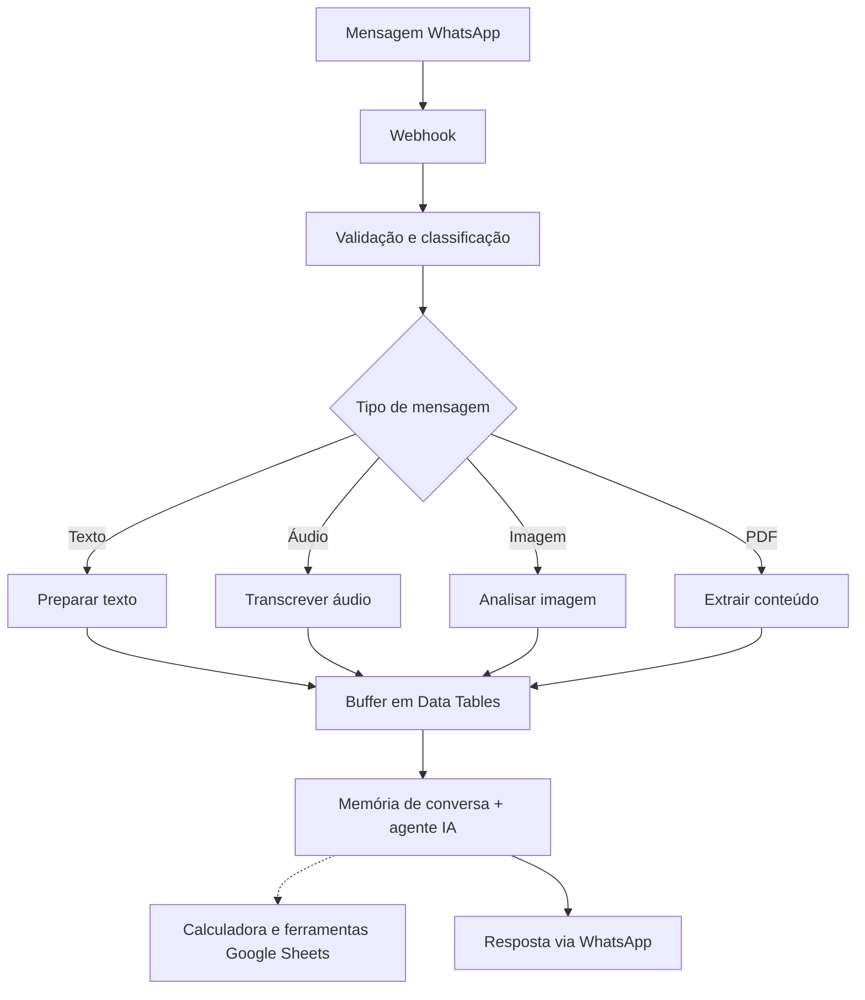

# Assistente de eventos culturais com IA — estudo de caso n8n

**Portfólio de Luis Adolfo Herrera Vargas** · Engenharia de Software · Automação e integração de sistemas

> Projeto apresentado de forma **retrospectiva e anonimizada**, com base na arquitetura de um fluxo criado para atendimento de um evento cultural em 2026. Este repositório contém apenas documentação técnica, e não o fluxo operacional original ou uma aplicação pronta para instalação.

## Problema e objetivo

Eventos com várias atividades precisam responder dúvidas sobre programação, inscrições, orientações e eventos paralelos em diferentes horários. O objetivo do fluxo foi estruturar um atendimento por WhatsApp com interpretação de mensagens, contexto conversacional e integração com ferramentas auxiliares, preservando regras de confirmação de operações.

## Tecnologias identificadas no workflow

| Tecnologia | Finalidade identificada no fluxo |
| --- | --- |
| **n8n** | Orquestração, tratamento de mensagens e chamada de ferramentas |
| **WAHA / WhatsApp** | Entrada e saída de mensagens |
| **Google Gemini** | Agente de IA e interpretação de imagem/áudio |
| **Redis** | Memória de conversação |
| **n8n Data Tables** | Buffer de mensagens antes da resposta |
| **Google Sheets** | Ferramentas de registro de informações vinculadas ao evento |
| **HTTP Request / Webhook** | Recebimento e obtenção de conteúdo externo |
| **JavaScript** | Preparação e agrupamento de mensagens nos nós Code |

## Arquitetura simplificada

*Diagrama conceitual baseado nas principais conexões observadas no export. Não representa cada desvio, campo ou condição da configuração original.*

## Aspectos técnicos estudados

- **Tratamento multimodal:** mensagens de texto, imagem, áudio e PDF seguem caminhos distintos antes de convergir para o atendimento.
- **Buffer de mensagens:** armazenamento temporário e agrupamento de mensagens próximas antes de enviá-las ao agente.
- **Memória conversacional:** recuperação de contexto para reduzir perda de continuidade no atendimento.
- **Regras de negócio:** instruções organizadas para interpretar perguntas sobre agenda e distinguir consultas informativas de operações que dependem de confirmação.
- **Ferramentas especializadas:** integração com planilhas para registrar informações em fluxos específicos; a resposta só deve declarar sucesso após retorno confiável da ferramenta.
- **Datas e validade:** tratamento de regras dependentes da data de um evento; esta documentação se refere a um evento já realizado, não a inscrições atuais.

## Escopo de demonstração

Este repositório documenta um **estudo de caso de arquitetura**. Ele **não** disponibiliza o JSON exportado do n8n, a base de participantes, as regras internas completas, as configurações reais, endpoints, chaves de API ou comprovantes.

Também não afirmamos que todos os cenários foram validados por testes automatizados. O arquivo de testes contém **cenários propostos** para uma futura demonstração sintética.

## Estrutura

- [`docs/arquitetura.md`](docs/arquitetura.md): responsabilidades dos componentes e observações técnicas
- [`docs/cenarios-de-teste.md`](docs/cenarios-de-teste.md): plano de testes com exemplos inventados
- [`docs/privacidade.md`](docs/privacidade.md): limites de divulgação e segurança

## Próximas melhorias possíveis

1. Construir uma implementação de demonstração independente com dados e canais fictícios.
2. Adicionar tratamento explícito de erros e testes para respostas de integrações.
3. Criar indicadores verificáveis de desempenho em um ambiente de testes.
4. Documentar controle de acesso, auditoria e gestão segura de segredos.

---

**Autor do portfólio:** [Luis Adolfo Herrera Vargas](https://github.com/adolfolhv2-79)  
**Objetivo:** estágio em tecnologia, com interesse em integração de sistemas, automação e IA aplicada.
